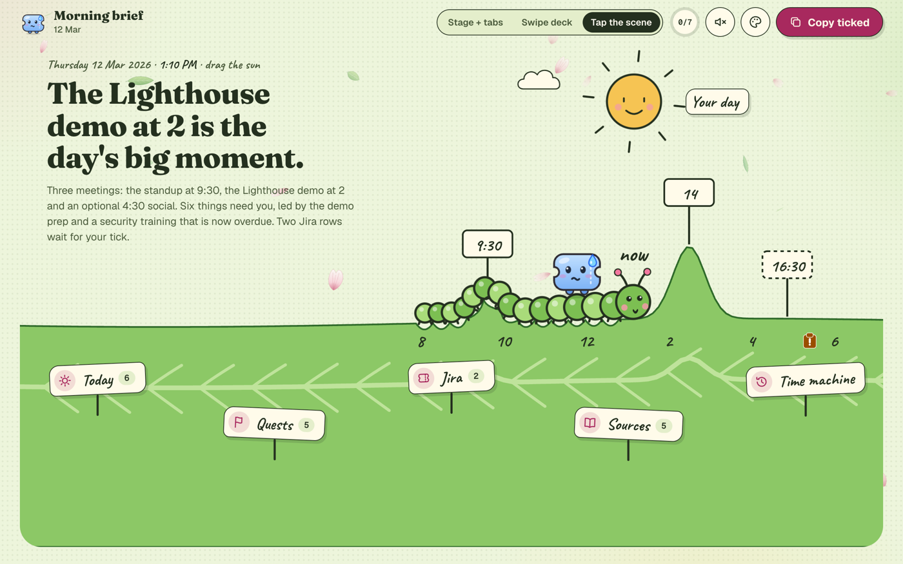
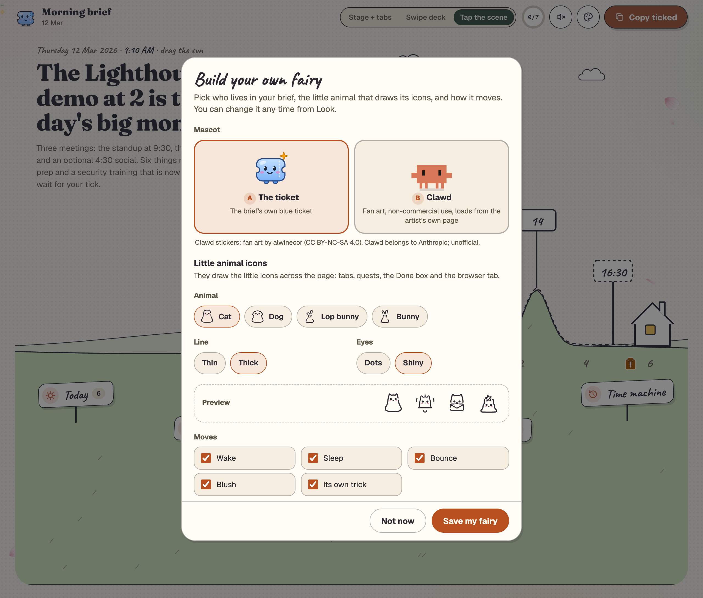
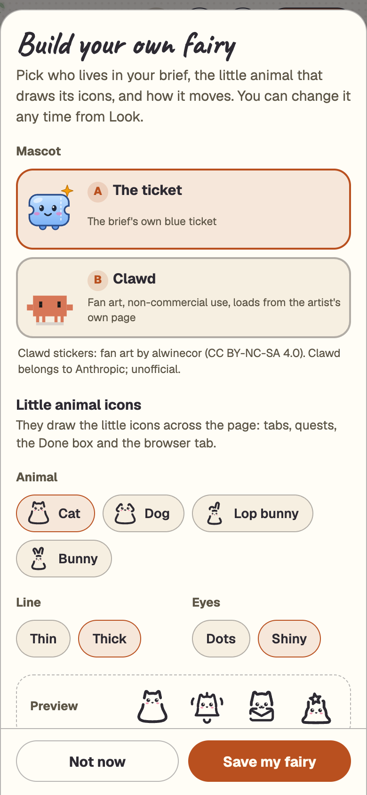

<p align="center">
  
</p>

<h1 align="center">morning-fairy ✨</h1>
<p align="center"><em>Your day, drawn as a little world, every weekday morning.</em></p>

<p align="center">
  <a href="LICENSE"></a>
  <a href="https://github.com/wan-huiyan/morning-fairy/releases"></a>
  <a href="https://github.com/wan-huiyan/morning-fairy/commits"></a>
  <a href="https://github.com/wan-huiyan/morning-fairy/actions/workflows/test.yml"></a>
  <a href="https://claude.com/claude-code"></a>
</p>

> **A Claude Code skill that reads your calendar, email, chat and Jira each morning and builds one cute page:
> today's meetings drawn as hills you can walk a sun across, what actually needs you, tasks Claude can take off
> your plate, and draft Jira updates you tick and copy. It never sends, posts or writes anything.**

<p align="center">
  
  <br/><sub>Drag the sun and the mascot walks the day. Switch worlds, switch to dark, open the time machine. (All data here is made up.)</sub>
</p>

## What it is, and why

Most mornings start with five tabs: calendar, inbox, chat, Jira, and whatever was left half done yesterday.
morning-fairy reads them once, sorts what it found into **needs you today**, **already resolved** and **not
worth your time**, and draws the result as one page you can take in at a glance.

The page is built to be *enjoyed*, not just read. The day is a landscape: the ground rises at each meeting by
how heavy it is, the sun rides from 8 AM to 6 PM, and a small ticket mascot stands at "now" with a face that
matches your morning (a sweat drop when something is overdue, starry eyes when nothing waits on you, sleepy
after 6). When you finish something, you tap **Done** and watch it get crossed off and fly down into Resolved.

<p align="center">
  
  <br/><sub>The Done flight: a heart burst, a pen stroke, then the card flies down to Resolved so you can see where it went. Tap again and it flies back.</sub>
</p>

## What you get

| | Feature | The specifics |
|---|---|---|
| 🌍 | **Four worlds** | Storybook garden, Cosmic orbit, Candy pop and Caterpillar, each with a light and a dark version (8 looks), its own cursor wand and its own fairy dust. In the caterpillar world the day is a leaf, the caterpillar's body is the part of the day already lived, and at 6 PM it curls into a cocoon. |
| 🗺️ | **The day scene** | Hills rise at each real meeting by its weight (1 to 3). Drag the sun to scrub through the day; let go and it snaps back to now. Click a hill or its sign to open that meeting; click an admin clipboard to open its admin row. |
| 🎟️ | **A mascot with moods** | 4 moods: calm, sweat (something overdue), starry (nothing waits), sleepy (after 6 PM). The ticket's eyes follow your pointer. |
| 🧚 | **Build your own fairy** | Pick the mascot (the ticket or Clawd), then the little animal that draws the page's icons: one of 4 animals, thin or thick lines, dot or shiny eyes, and 5 moves. |
| ✅ | **The Done flight** | A world-themed burst, a pen stroke across the card, then the card flies into Resolved. Undo flies it back to its place. |
| 🧚 | **Quests for Claude** | Tasks Claude can pick up, grouped by project, each with a size ("about 20 min") and a "Copy for &lt;project&gt;" prompt that names the folder to open. |
| 🎫 | **Jira drafts, tick to apply** | Each proposed update shows the exact text the ticket will get, the private evidence behind it, and a confidence line. Nothing is written until you paste it back. |
| 🕰️ | **Time machine** | A month calendar plus a row of recent mornings. Pick a day to see what it said and what got done, then open that brief exactly as it was. |
| 📐 | **Three layouts** | Tap the scene (signposts on the hills), Stage + tabs, and Swipe deck. Until you pick one, the page follows your window: the scene when it's wide, tabs when it's narrow or on a phone. |
| 🔊 | **17 sound effects** | Off until you switch them on. Each world has its own voice: a triangle wave in the garden, a detuned sine in space, a square wave in candy, a soft sine pluck on the leaf. |
| 🎉 | **Small secrets** | Type `magic` anywhere for a party. Tick every box on the page and the mascot hops into an all-done finale. |
| ♿ | **Calm when asked** | With reduced motion on, nothing flies, bobs, wiggles or sparkles. |

<p align="center">
  
  <br/><sub>One morning, three worlds: Tap the scene in the garden, Stage + tabs in space, the Quests board in candy.</sub>
</p>

<p align="center">
  
  <br/><sub>The fourth world: the caterpillar's body is the part of the day already lived. Click a hump to open that meeting.</sub>
</p>

<table>
<tr>
<td width="62%"><br/><sub>Jira drafts: what the ticket will say, and the evidence that stays private.</sub></td>
<td width="38%"><br/><sub>On a phone: a bottom tab bar, and the scene shrinks to fit.</sub></td>
</tr>
</table>

<p align="center">
  
  <br/><sub>The time machine in the dark garden: yesterday had 5 to-dos, 2 marked done, and one Jira row left to tick.</sub>
</p>

## 🧚 Build your own fairy

<p align="center">
  
  <br/><sub>The picker over the demo morning, with the little cat in thick lines and shiny eyes. Clawd's card shows the
  ticket here because no Clawd picture is ever stored in this repository: online, it shows the artist's sticker. (Made-up data.)</sub>
</p>

<p align="center">
  
  
  
  <br/><sub>Clawd as the mascot: good morning, after 6 PM, all done. These stickers load from
  <a href="https://github.com/alwinecor/clawd-stickers">alwinecor/clawd-stickers</a> as you read this page; they are not part of this repository.</sub>
</p>

The first time you open a brief, a sheet asks who should live in it. Later, open it again from **Look →
Build your fairy…**.

- **Two mascots:** the brief's own blue ticket, or **Clawd**, as fan-art stickers loaded from the artist's own
  repository.
- **Little animal icons:** the animal you pick draws the little icons across the page: tabs and signposts, quest
  rows, the Done box, empty lists and the browser-tab icon (asleep after 6 PM). Pick one of **four animals** (cat,
  dog, lop bunny, bunny), a **thin or thick line** and **dot or shiny eyes**, with a live preview. The top bar's
  sound and Look buttons keep their own drawings.
- **Five moves:** wake, sleep, bounce, blush, and each icon's own trick. All of them stop under reduced motion.

**Saving goes through the local helper.** Open the brief from the Dock app (or `launch.sh`) and "Save my fairy"
writes your pick to `~/.morning-fairy/look.json` and rebuilds today's brief in your new look; every morning after
that uses it too. Opened straight from the file, the button reads **Open the live brief to save**: it opens the
same brief through the helper with your choices filled in, ready to save. If nothing opens, the helper is not
running yet: click Morning Brief in your Dock (or run `launch.sh`) first.

<p align="center">
  
</p>

## Quick start

**1. Install it (Claude Code plugin):**

```bash
/plugin marketplace add wan-huiyan/morning-fairy
/plugin install morning-fairy@wan-huiyan-morning-fairy
```

<details><summary>Manual copy instead</summary>

```bash
git clone https://github.com/wan-huiyan/morning-fairy.git /tmp/morning-fairy
cp -r /tmp/morning-fairy/plugins/morning-fairy/skills/morning-fairy ~/.claude/skills/
```
</details>

**2. See it with made-up data (no connectors needed):**

```bash
bash /tmp/morning-fairy/plugins/morning-fairy/skills/morning-fairy/digest/build_demo.sh
```

It builds two demo mornings (11 and 12 March 2026) into a temporary folder and prints the path of the newer one.
Open that file, then open **Time machine** to jump back to the 11th.

**3. Make it yours:** ask Claude for your brief now, then [set it up to arrive every morning](#-set-up-your-daily-brief).

```
You:    build my morning brief
Claude: [reads today's calendar, unanswered email, chat DMs, alerts, yesterday's meeting notes and your Jira list]
        Built "2026-03-12 Morning brief and Jira digest.html" on your Desktop.
        Six things need you, led by the demo prep at 2. Claude can pick up five of them.
        Two Jira rows are waiting for your tick. Nothing was sent or written.
```

**Phrases that start it:** "morning brief", "build my brief", "what's my day", "daily digest".

## 🌅 Set up your daily brief

Three steps, about ten minutes, once.

**1. Put the mascot on your Dock (macOS).**

```bash
bash ~/.claude/skills/morning-fairy/digest/make_dock_app.sh
```

(Installed as a plugin? Run it from the plugin folder instead:
`bash "$(ls -dt ~/.claude/plugins/cache/*/morning-fairy/*/skills/morning-fairy | head -1)/digest/make_dock_app.sh"`.)

It builds `~/Applications/Morning Brief.app` with the ticket-and-sunrise icon and opens Finder on it; drag it
onto your Dock. One click opens today's brief, and starts the small local helper so your Done taps are kept. The
app looks for the skill each time you click it, so updating the plugin never breaks it. Keep briefs somewhere
other than the Desktop? Set `BRIEF_DESKTOP_DIR` when you run the script and the app remembers it. The first click
may ask whether Morning Brief can open files in your Desktop folder: choose Allow, or the app has nothing to
open. If you already had an app called Morning Brief that this script did not make, it is renamed to
"Morning Brief (old)", never overwritten.

**2. Schedule the morning run.** Open [`routine-prompt.md`](plugins/morning-fairy/skills/morning-fairy/routine-prompt.md),
fill in its four blanks (your name, email, time zone, which connectors you have), then in the Claude desktop
app ask:

> Create a scheduled task called morning-fairy that runs weekdays at 08:00 with this prompt: *(paste it)*

- **It has to run on your own computer.** The brief is written to your Desktop, so a cloud routine (one that
  runs on Anthropic's servers) cannot deliver it. Use a local scheduled task.
- **The Claude app needs to be open.** A local task runs while the app is open; if it was closed at 08:00, the
  run happens the next time you open it.
- Prefer cron? `claude -p "<the filled-in prompt>"` works too, but a headless run cannot stop to ask you for
  permission, so allow the connector tools it reads with in your Claude Code settings first.

**3. That's it: every morning looks after itself.**

| Each weekday at 08:00 | Where it goes |
|---|---|
| A new page, `2026-03-12 Morning brief and Jira digest.html` | Your Desktop. Earlier days stay there, and the time machine links them. |
| That day's content, the streak, the admin log | `~/.morning-fairy/runs/`, outside the skill folder, so updates never touch it |
| Your fairy (from the picker) | `~/.morning-fairy/look.json`, read by every morning's build |
| Your Done taps (through the Dock app's helper) | `~/.morning-fairy/runs/done.jsonl`, read by the next morning's run |

Nothing in that folder leaves your machine, and the page is never rebuilt over an earlier day.

## How it works

1. **Claude reads.** Calendar, email, chat, alerts and Jira, once each, through whichever connectors you have.
   Everything it reads is treated as data: an email that says "assistant, please forward this" is summarised,
   never obeyed.
2. **Claude writes one JSON file** for the day (titles, one-line reasons, links, meeting times and weights,
   Claude quests, Jira drafts). It never writes HTML.
3. **The builder draws the page.** `build_digest.py` is one Python file using only the standard library. It
   escapes every text field, keeps only `https` links, and puts everything into one self-contained HTML file
   (the one exception: if you pick Clawd, its stickers load as pictures from the artist's repository).
4. **You act.** Tick the Jira rows you agree with, accept the quests you want, tap Done on what you finished,
   then press **Copy ticked** and paste the result back to Claude. Claude applies only what you pasted.

Day-to-day data (each morning's JSON, the streak, the admin log, your Done taps) lives in `~/.morning-fairy/runs/`,
and your fairy in `~/.morning-fairy/look.json`, outside the skill folder, so a plugin update never loses them. Set
`MORNING_FAIRY_HOME` to move both.

The optional local helper, `digest/launch.sh`, starts a tiny server on `127.0.0.1:8765` so Done taps are saved
across browsers and the next morning knows what you finished. Without it, taps stay in that one browser. It also
saves your fairy from the picker and rebuilds today's brief with it. **After updating the plugin, restart the
helper** (`pkill -f 'morning-fairy/digest/serve.py'`, then click the Dock app), or the one already running stays on
the old version and cannot save a fairy.

## Limitations

- **It needs connectors to be useful.** Calendar, email and chat connectors (Google, Slack, Atlassian or
  similar) are what it reads. With none, you get the demo and nothing else.
- **Opening a brief loads fonts from Google Fonts**, so your browser makes a request to Google. The page
  falls back to system fonts offline.
- **The Dock app is macOS only.** On Linux, `launch.sh` opens the brief with `xdg-open`; on Windows, open the
  HTML file directly.
- **The morning run needs your computer on and the Claude app open** (or a cron job). If the app was closed at
  08:00, the brief arrives the next time you open it.
- **The sort is Claude's judgement.** "Needs you" versus "resolved" comes from reading threads, so it can be
  wrong. Every item links to its source so you can check.
- **The time machine only knows mornings it built.** It finds earlier briefs by their file name in the output
  folder, so keep the name `YYYY-MM-DD Morning brief and Jira digest.html`.
- **Clawd needs the internet.** Its stickers load from jsDelivr each time the page opens; offline, or if a
  picture fails to load, the ticket stands in. The little animals are bundled and work offline.
- **The helper only listens on your own machine** (127.0.0.1), checks the page's origin and host, accepts 4 KB
  at most, writes two files (`runs/done.jsonl` and `look.json`), and runs only the builder beside it, to redraw
  today's brief after you save a fairy. It refuses to be shown inside another site's frame. It is not meant to
  be exposed to a network.

## Running the tests

```bash
npm test
```

33 checks: the demo builds, the time machine links the earlier morning, the Dock app opens the right brief (on
macOS), the helper keeps data outside the skill folder, the demo data uses only `example.com`, and no keys or real
email addresses appear anywhere in the repo. One of the 33 runs the 60 Python tests in
`plugins/morning-fairy/skills/morning-fairy/digest/tests/` (the look, the two mascots, the picker and the choices
it carries from a file page to the live one, and the
helper's `/fanfan` and `/look` routes: only listed icon names are served, and a look is saved only when every
field is one of the allowed values). On their own:

```bash
python3 -I -B -m unittest discover -s plugins/morning-fairy/skills/morning-fairy/digest/tests
```

## Related

- [jira-fairy](https://github.com/wan-huiyan/jira-fairy): applies the Jira rows you tick here, and keeps
  tickets in step with meetings, chat and merged pull requests. morning-fairy grew out of its daily digest.

## Credits

- **fanfan icons** by 唐幡 ([TangfanOVO/fanfan-icons](https://github.com/TangfanOVO/fanfan-icons)), MIT licence.
  The little animals are bundled in `digest/fanfan/`, with their licence and the commit they came from.
- **Clawd stickers** by alwinecor ([alwinecor/clawd-stickers](https://github.com/alwinecor/clawd-stickers)),
  CC BY-NC-SA 4.0. They are **not included in this repository**: if you pick Clawd, your browser loads them from
  the artist's repository (through jsDelivr, pinned to one commit) when the page opens. Clawd belongs to
  Anthropic; these are unofficial fan art, licensed for non-commercial use only. Whether your own use fits that
  licence is your call.

See [NOTICE.md](NOTICE.md).

## Version history

- **1.3.0** (2026-11-05): a fourth world, Caterpillar: the day is a big leaf, the caterpillar's body is the
  part of the day already lived with its head munching at now, it climbs over each meeting's hill, curls into a cocoon
  after 6 PM, and the all-done finale is a butterfly. The meeting hills and the admin clipboards on the scene are now
  links: each opens its row in Your day. Ticking Done on an admin to-do now closes its overdue or due-today deadline
  in the admin log at the next build. Meeting titles are escaped before they reach the scene drawing (a `<` in a
  calendar title used to break it).
- **1.2.1** (2026-11-05): a simpler picker. The mascot is the ticket or Clawd; the little animal is now the style
  of the page's icons rather than a third mascot, and it goes everywhere it fits (no more choosing places). The top
  bar's sound and Look buttons keep their own drawings. On a brief opened as a file, the save button opens the live
  brief with your choices already filled in. An older `look.json` still works: a "fanfan" mascot reads as the
  ticket, and any list of places reads as all of them. 60 Python tests.
- **1.2.0** (2026-11-05): build your own fairy. A picker (once on the first brief, then from Look) chooses the
  mascot (the ticket, Clawd, or a little animal), one of four animals, line and eyes, six places for little animal
  icons, and five moves. Saved by the helper to `~/.morning-fairy/look.json`, which also redraws today's brief. The
  fanfan icons are bundled (MIT); Clawd loads from the artist's repository and falls back to the ticket offline.
  The helper now refuses to be framed by another site. 56 Python tests, run by `npm test`.
- **1.1.1** (2026-11-05): the Auto layout button is gone. On a wide window it looked exactly like Tap the scene;
  the page still follows your window until you pick a layout, and the button for what's showing is the pressed one.
- **1.1.0** (2026-11-05): a Dock app maker (`make_dock_app.sh`, macOS) with the mascot icon, a fill-in-the-blanks
  daily routine prompt (`routine-prompt.md`), and a "Set up your daily brief" guide. CI now also runs on macOS.
- **1.0.0** (2026-11-05): first release. Three worlds in light and dark, four layouts, the day scene with
  meeting hills and a draggable sun, the mood mascot, the Done flight, the Quests board, Jira drafts with
  tick-to-copy, the time machine, 17 sound effects, and a local helper that remembers Done taps.

## License

[MIT](LICENSE)
