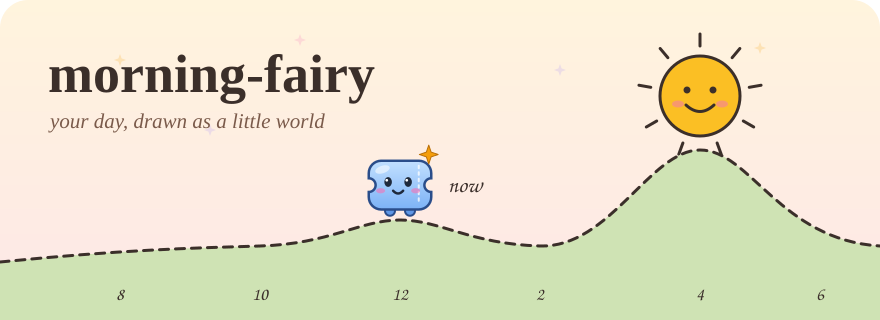
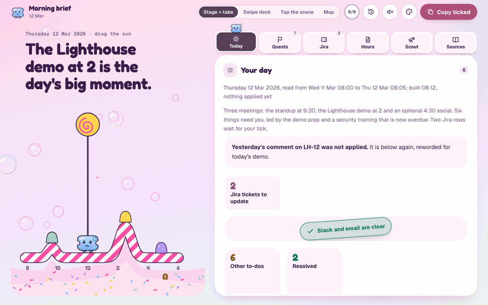
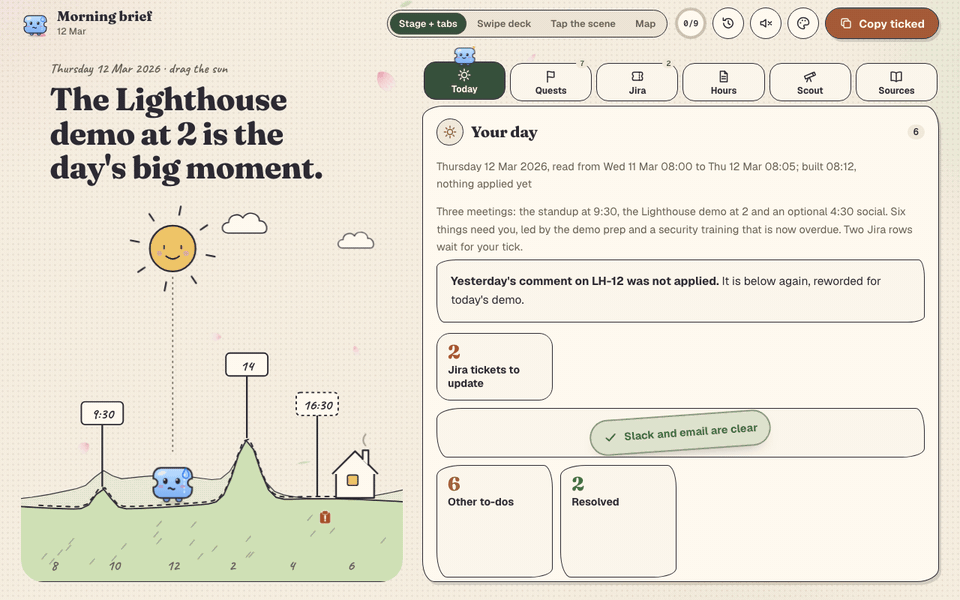
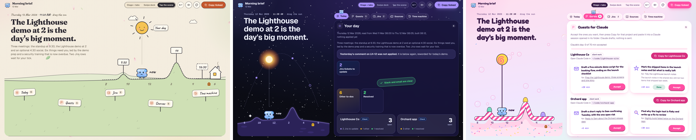
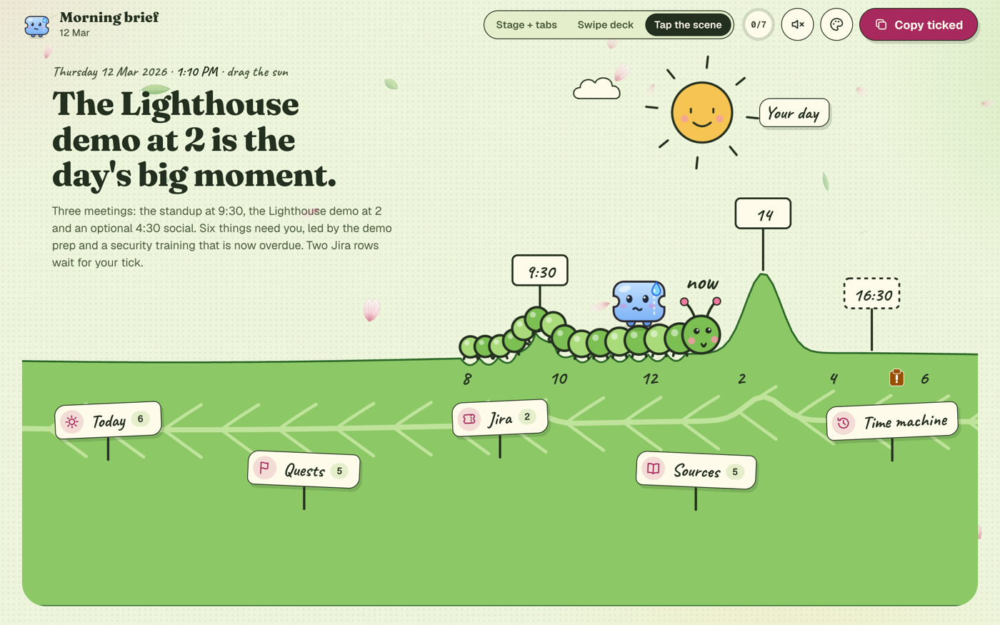
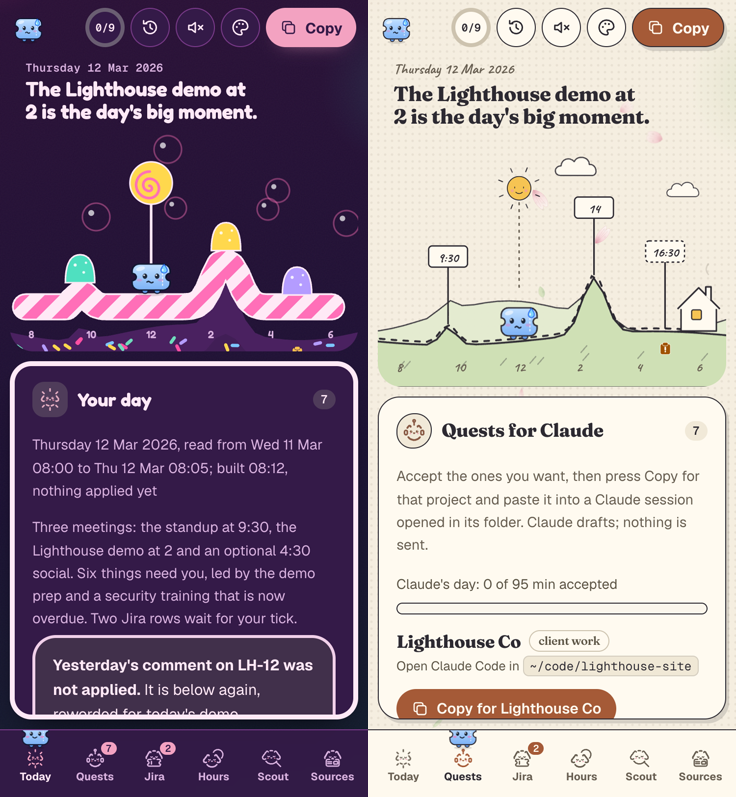
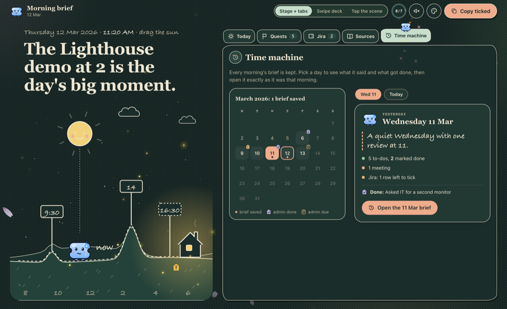
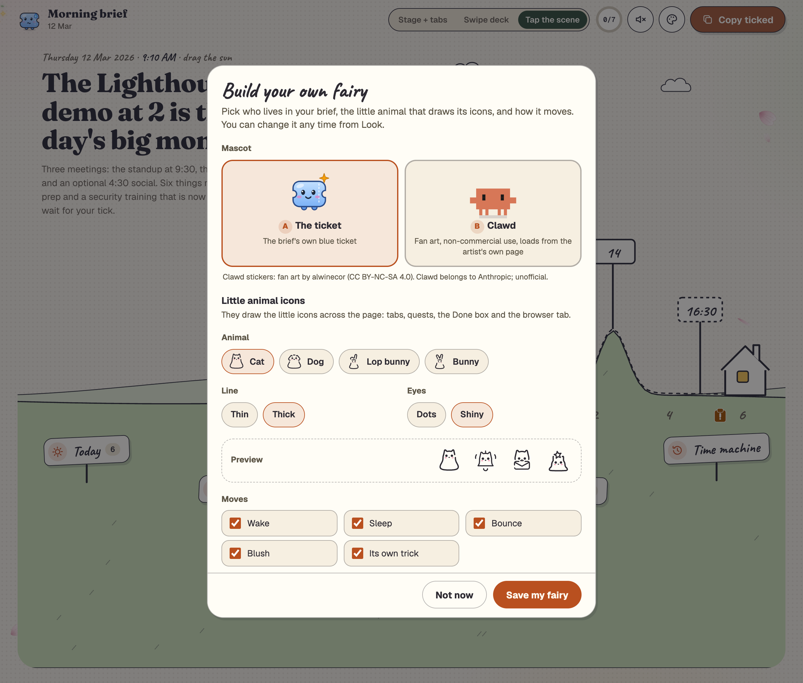
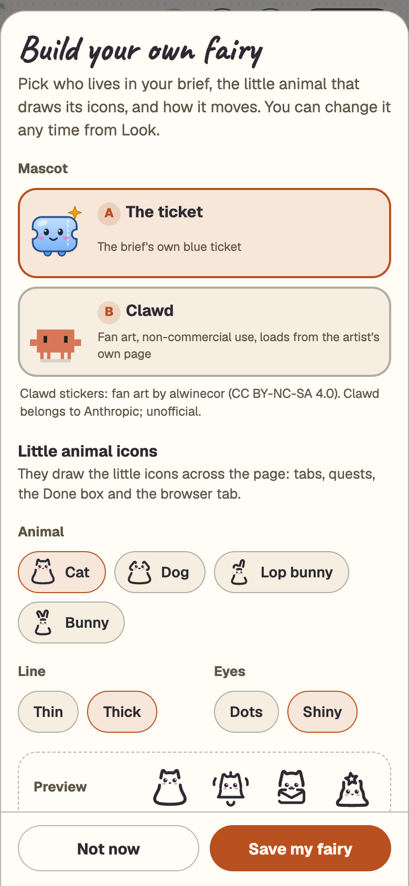

<p align="center">
  
</p>

<h1 align="center">morning-fairy ✨</h1>
<p align="center"><em>Your day, drawn as a little world, every weekday morning.</em></p>

<p align="center">
  <a href="LICENSE"></a>
  <a href="https://github.com/wan-huiyan/morning-fairy/releases"></a>
  <a href="https://github.com/wan-huiyan/morning-fairy/commits"></a>
  <a href="https://github.com/wan-huiyan/morning-fairy/actions/workflows/test.yml"></a>
  <a href="https://claude.com/claude-code"></a>
</p>

> **A Claude Code skill that reads your calendar, email, meeting notes, chat, Jira and GitHub each morning, plus
> your own Claude Code sessions and cloud bill if you switch those on, and builds one cute page: today's meetings
> drawn as hills you can walk a sun across, what actually needs you, tasks you can hand to Claude with their
> context attached, draft Jira updates you tick and copy, and the hours you have not logged yet. The morning run
> never sends, posts or changes anything in your mail, chat, calendar or Jira.**

<p align="center">
  
  <br/><sub>Drag the sun and the mascot walks the day. Switch worlds (garden, cosmic, candy, caterpillar), switch to dark, open the time machine. (All data here is made up.)</sub>
</p>

## What it is, and why

Most mornings start with five tabs: calendar, inbox, chat, Jira, and whatever was left half done yesterday.
morning-fairy reads them once, sorts what it found into **needs you today**, **already resolved** and **not
worth your time**, and draws the result as one page you can take in at a glance.

The page is built to be *enjoyed*, not just read. The day is a landscape: the ground rises at each meeting by
how heavy it is, the sun rides from 8 AM to 6 PM, and a small ticket mascot stands at "now" with a face that
matches your morning (a sweat drop when something is overdue, starry eyes when nothing waits on you, sleepy
after 6). When you finish something, you tap **Done** and watch it get crossed off and fly down into Resolved.

<p align="center">
  
  <br/><sub>The Done flight: a heart burst, a pen stroke, then the card flies down to Resolved so you can see where it went. Tap again and it flies back.</sub>
</p>

<p align="center">
  
  <br/><sub>Two optional tabs. <b>Hours</b>: your week measured from your local Claude Code logs and calendar, a timeline you click blocks in and out of, and one button that has Claude log the day in Tempo. <b>Scout</b>: web finds tied to your own projects (here, a tool for this week's failing Orchard build); accept one and it joins that project's quests. (Made-up data.)</sub>
</p>

## 🔌 Where the data comes from

<p align="center">
  
  <br/><sub>The morning round: one house per tool you connect, one page, then the to-do you pick goes to Claude with its context.</sub>
</p>

morning-fairy has no data of its own. Every morning it reads the tools you already use, through the connectors and
command-line tools your Claude Code session can reach, and only those. The more you connect, the more of your day
it can see.

| Source | What the fairy reads it for | How Claude reaches it | Used by |
|---|---|---|---|
| 📅 **Calendar** (Google Calendar) | Today's meetings, which become the hills; tomorrow's meetings to prep for; the meetings that go into your hours | Calendar connector | The day scene (core) |
| ✉️ **Email** (Gmail) | Threads where you were asked and have not replied, deadlines sent to you by name (training, timesheets, access reviews), alert emails such as a failing job, and Jira notification emails | Email connector | The to-do list (core) |
| 📝 **Meeting notes** | What was agreed in yesterday's meetings, as evidence for Jira updates. It prefers the raw transcript over an AI summary | Wherever your notes land. For example, Google Meet's "Notes by Gemini" arrive by email and link to a Google Doc, which needs a Google Drive connector to open | Jira drafts |
| 💬 **Chat** (Slack) | Every direct and group message in the window, not only mentions; project channels as evidence for Jira | Slack connector | The to-do list (core) |
| 🎫 **Jira** | Your assigned tickets and what each one already says, so a draft never repeats what the ticket shows | Atlassian connector | Jira drafts |
| 🐙 **GitHub** | Merged pull requests as evidence for Jira; the live state of anything carried over from yesterday ("to merge" may have merged overnight); Scout searches | The `gh` command-line tool, signed in | Jira drafts; Scout (optional) |
| ☁️ **Google Cloud** | What BigQuery queries cost this month in each project you work in | `gcloud` and `bq`, signed in | Cloud spend (optional) |
| 🤖 **Your local Claude Code logs** | The time stamp on every message in the session logs Claude Code keeps on this computer (`~/.claude/projects/`), turned into hours per project. Sessions you run elsewhere (claude.ai, Claude Code on the web, another machine) are not seen | Local files, no connector | Timesheet hours (optional) |
| ⏱ **Tempo** (the timesheet app inside Jira) | What you have already logged, and, after you approve the hours on the page, logging them | Claude in Chrome, signed in to Tempo ([why the browser](#-timesheet-hours-optional-off-by-default)) | Timesheet hours (optional) |
| 🔭 **The web** | New repositories, the Claude Code changelog and Hacker News, for ideas that could help your projects | `gh`, web search | Scout (optional) |
| ✅ **Your Done taps** | What you finished on earlier briefs, so it does not come back as a to-do | `~/.morning-fairy/runs/done.jsonl`, written by the local helper | Automatic |

**How to connect them.** Gmail, Google Calendar, Google Drive, Slack and Atlassian (Jira) are connectors you
switch on once in Claude ([claude.ai](https://claude.ai) → Settings → Connectors); Claude Code sessions signed in to
the same account see them as tools. Other connectors that give Claude the same reads (Outlook instead of Gmail,
say) should work too, but only the ones named here have been used. The command-line tools need one sign-in each:
`gh auth login`, and for spend `gcloud auth login` (which also signs in `bq`). Then list what you have in step 3 of the [routine prompt](plugins/morning-fairy/skills/morning-fairy/routine-prompt.md).
A source that cannot be reached one morning does not stop the run: the page is built anyway and says at the top
which source was missing.

**What it does not read:** your browser history, or any tool you have not given it a connector or a sign-in for.
The one place it uses your browser is the two hours sessions (Fill Tempo and Approve and log), which start with
Claude in Chrome so they can open your Tempo page; like any Claude in Chrome session, they act in your signed-in
Chrome. What the morning run finds goes into that morning's brief (on your Desktop) and its files in
`~/.morning-fairy/`.

## What you get

| | Feature | The specifics |
|---|---|---|
| 🌍 | **Four worlds** | Storybook garden, Cosmic orbit, Candy pop and Caterpillar, each with a light and a dark version (8 looks), its own cursor wand and its own fairy dust. In the caterpillar world the day is a leaf, the caterpillar's body is the part of the day already lived, and at 6 PM it curls into a cocoon. |
| 🗺️ | **The day scene** | Hills rise at each real meeting by its weight (1 to 3). Drag the sun to scrub through the day; let go and it snaps back to now. Click a hill or its sign to open that meeting; click an admin clipboard to open its admin row. |
| 🎟️ | **A mascot with moods** | 4 moods: calm, sweat (something overdue), starry (nothing waits), sleepy (after 6 PM). The ticket's eyes follow your pointer. |
| 🧚 | **Build your own fairy** | Pick the mascot (the ticket or Clawd), then the little animal that draws the page's icons: one of 4 animals, thin or thick lines, dot or shiny eyes, and 5 moves. |
| ✅ | **The Done flight** | A world-themed burst, a pen stroke across the card, then the card flies into Resolved. Undo flies it back to its place. |
| 🧚 | **Quests for Claude** | Tasks Claude can pick up, grouped by project, each with a size ("about 20 min") and a "Copy for &lt;project&gt;" prompt that names the folder to open. Optionally, a **Start in Claude** button opens the session for you. |
| 🔭 | **Scout: worth a look** | Optional. A chapter of web finds (new repos, a tool's changelog, Hacker News) that could improve your work, each saying which of your projects it helps and why. They are offers, not to-dos: nothing waits on you, no Done pill, and each ask is read-and-assess only. |
| 💸 | **Cloud spend** | Optional. What BigQuery queries have cost this month in each Google Cloud project you work in: a little bar per day, the month-end pace, the account that spent most, and a sweating mascot when a day jumps. |
| 🎫 | **Jira drafts, tick to apply** | Each proposed update shows the exact text the ticket will get, the private evidence behind it, and a confidence line. Nothing is written until you paste it back. Tickets that already match sit folded underneath as "Already up to date". |
| 🕰️ | **Time machine** | A month calendar plus a row of recent mornings. Pick a day to see what it said and what got done, then open that brief exactly as it was. |
| 📐 | **Four layouts** | Tap the scene (signposts on the hills), Stage + tabs, Swipe deck (tap the card in the middle, or its Enlarge button, and it grows into a big reading view), and Map: every section is a numbered level on the hills, joined by a dashed path; the mascot hops to the one you open, its level pops up as a card with Back and Next level, a level turns into a check once you have ticked everything in it, and an XP bar counts today's ticks. Until you pick one, the page follows your window: the scene when it's wide, tabs when it's narrow or on a phone. |
| 🔊 | **18 sound effects** | Off until you switch them on. Each world has its own voice: a triangle wave in the garden, a detuned sine in space, a square wave in candy, a soft sine pluck on the leaf. |
| 🎉 | **Small secrets** | Type `magic` anywhere for a party. Tick every box on the page and the mascot hops into an all-done finale. |
| ♿ | **Calm when asked** | With reduced motion on, nothing flies, bobs, wiggles or sparkles. |

<p align="center">
  
  <br/><sub>One morning, three worlds: Tap the scene in the garden, Stage + tabs in space, the Quests board in candy.</sub>
</p>

<p align="center">
  
  <br/><sub>The fourth world: the caterpillar's body is the part of the day already lived. Click a hump to open that meeting.</sub>
</p>

<table>
<tr>
<td width="62%"><br/><sub>Jira drafts: what the ticket will say, and the evidence that stays private.</sub></td>
<td width="38%"><br/><sub>On a phone: a bottom tab bar, and the scene shrinks to fit.</sub></td>
</tr>
</table>

<p align="center">
  
  <br/><sub>The time machine in the dark garden: yesterday had 5 to-dos, 2 marked done, and one Jira row left to tick.</sub>
</p>

## 🧚 Build your own fairy

<p align="center">
  
  <br/><sub>The picker over the demo morning, with the little cat in thick lines and shiny eyes. Clawd's card shows the
  artist's sticker, fan art by alwinecor (CC BY-NC-SA 4.0; see Credits). (Made-up data.)</sub>
</p>

<p align="center">
  
  
  
  <br/><sub>Clawd as the mascot: good morning, after 6 PM, all done. These stickers load from
  <a href="https://github.com/alwinecor/clawd-stickers">alwinecor/clawd-stickers</a> as you read this page; they are not part of this repository.</sub>
</p>

The first time you open a brief, a sheet asks who should live in it. Later, open it again from **Look →
Build your fairy…**.

- **Two mascots:** the brief's own blue ticket, or **Clawd**, as fan-art stickers loaded from the artist's own
  repository.
- **Little animal icons:** the animal you pick draws the little icons across the page: tabs and signposts, quest
  rows, the Done box, empty lists and the browser-tab icon (asleep after 6 PM). Pick one of **four animals** (cat,
  dog, lop bunny, bunny), a **thin or thick line** and **dot or shiny eyes**, with a live preview. The top bar's
  sound and Look buttons keep their own drawings.
- **Five moves:** wake, sleep, bounce, blush, and each icon's own trick. All of them stop under reduced motion.

**Saving goes through the local helper.** Open the brief from the Dock app (or `launch.sh`) and "Save my fairy"
writes your pick to `~/.morning-fairy/look.json` and rebuilds today's brief in your new look; every morning after
that uses it too. Opened straight from the file, the button reads **Open the live brief to save**: it opens the
same brief through the helper with your choices filled in, ready to save. If nothing opens, the helper is not
running yet: click Morning Brief in your Dock (or run `launch.sh`) first.

<p align="center">
  
</p>

## Quick start

**1. Install it** (type these in Claude Code):

```bash
/plugin marketplace add wan-huiyan/morning-fairy
/plugin install morning-fairy@wan-huiyan-morning-fairy
```

<details><summary>Manual copy instead</summary>

```bash
mkdir -p ~/.claude/skills
git clone https://github.com/wan-huiyan/morning-fairy.git ~/morning-fairy-src
cp -R ~/morning-fairy-src/plugins/morning-fairy/skills/morning-fairy ~/.claude/skills/
```
Then start a new Claude Code session so it sees the skill.
</details>

**2. Say this to Claude:**

```
set up morning fairy
```

Claude walks you through it, about ten minutes, once:

1. **Checks your computer** with `doctor.py`: Python, the folders the brief writes to, `gh` and `gcloud` and
   whether they are signed in, and your optional settings. Each problem comes with a one-line fix; "off" only
   means an optional part you have not turned on.
2. **Tests each connector with one small read** (today's calendar, one email search, Slack, your Jira sites,
   meeting notes) and shows you a table of what works, what is missing, what the brief loses without it, and
   where to switch it on (claude.ai, Settings, Connectors). A connector that is listed but does not answer shows up
   here, not on your first morning. It never asks for a password or key.
3. **Asks your name, email and time zone**, offering what your calendar already says, and which optional tabs you
   want (Scout, Cloud spend, Timesheet hours, Start in Claude).
4. **Writes your routine prompt** to `~/.morning-fairy/routine-prompt.md`, listing only the sources that passed.
5. **Builds your first brief** on the Desktop, from your real day.
6. **On a Mac, puts the mascot on your Dock**, if you say yes.
7. **Schedules the weekday 08:00 run**, if the session can create a local scheduled task and you say yes; if not,
   it gives you the exact sentence to say in the Claude desktop app.

```
You:    set up morning fairy
Claude: Your computer is ready (gh signed in; gcloud not installed, so Cloud spend stays off).
        Calendar, Gmail and Slack answered. Jira reaches one site: which project key is the brief for?
        Google Drive is not connected, so meeting transcripts linked from email cannot be opened:
        switch it on in claude.ai, Settings, Connectors, or carry on without it.
```

Run the check-up yourself any time:

```bash
# installed as a plugin
python3 -I "$(ls -dt ~/.claude/plugins/cache/*/morning-fairy/*/skills/morning-fairy | head -1)/digest/doctor.py"
# copied by hand
python3 -I ~/.claude/skills/morning-fairy/digest/doctor.py
```

**Just want to look first?** Say "show me the morning fairy demo". Claude builds two made-up mornings (11 and 12
March 2026, no connectors needed) and opens the newer one; click the clock in the top row to jump back to the
11th. By hand (copied install; on Linux use `xdg-open`): `open "$(bash ~/.claude/skills/morning-fairy/digest/build_demo.sh)"`.
The demo pages go to a new temporary folder.

**Phrases that start it:** "morning brief", "build my brief", "what's my day", "daily digest", "set up morning fairy".

## 🌅 Set up your daily brief by hand

"Set up morning fairy" does all of this with you. To do it yourself: four steps, about ten minutes, once.

**1. Put the mascot on your Dock (macOS).**

```bash
bash ~/.claude/skills/morning-fairy/digest/make_dock_app.sh
```

(Installed as a plugin? Run it from the plugin folder instead:
`bash "$(ls -dt ~/.claude/plugins/cache/*/morning-fairy/*/skills/morning-fairy | head -1)/digest/make_dock_app.sh"`.)

It builds `~/Applications/Morning Brief.app` with the ticket-and-sunrise icon and opens Finder on it; drag it
onto your Dock. One click opens today's brief, and starts the small local helper so your Done taps are kept. The
app looks for the skill each time you click it, so updating the plugin never breaks it. Keep briefs somewhere
other than the Desktop? Set `BRIEF_DESKTOP_DIR` when you run the script and the app remembers it. The first click
may ask whether Morning Brief can open files in your Desktop folder: choose Allow, or the app has nothing to
open. If you already had an app called Morning Brief that this script did not make, it is renamed to
"Morning Brief (old)", never overwritten.

**2. Schedule the morning run.** Open [`routine-prompt.md`](plugins/morning-fairy/skills/morning-fairy/routine-prompt.md)
(or the filled-in copy setup saved as `~/.morning-fairy/routine-prompt.md`). Fill in your name, email, time zone and
the Sources line (the connectors you have, Jira with its project key), and delete steps 7 (Scout) and 8 (Cloud
spend) unless you want them. Copy everything below its line, then in the Claude desktop app ask:

> Create a scheduled task called morning-fairy that runs weekdays at 08:00 with this prompt: *(paste it)*

- **It has to run on your own computer.** The brief is written to your Desktop, so a cloud routine (one that
  runs on Anthropic's servers) cannot deliver it. Use a local scheduled task.
- **The Claude app needs to be open.** A local task runs while the app is open; if it was closed at 08:00, the
  run happens the next time you open it.
- Prefer cron? `claude -p "<the filled-in prompt>"` works too, but a headless run cannot stop to ask you for
  permission: first allow the connectors it reads in `~/.claude/settings.json` under `permissions.allow` (for
  example `"mcp__claude_ai_Gmail"`, `"mcp__claude_ai_Google_Calendar"`), and check that a headless run sees them.

**3. Build today's brief now** so the Dock app has something to open: in Claude Code, say "build my brief".

**4. That's it: every morning looks after itself.**

| Each weekday at 08:00 | Where it goes |
|---|---|
| A new page, `2026-03-12 Morning brief and Jira digest.html` | Your Desktop. Earlier days stay there, and the time machine links them. |
| That day's content, the streak, the admin log | `~/.morning-fairy/runs/`, outside the skill folder, so updates never touch it |
| Your fairy (from the picker) | `~/.morning-fairy/look.json`, read by every morning's build |
| Your settings (`routine-prompt.md`, and `clients.json`, `start.json` if you turned those on) | `~/.morning-fairy/`, so a plugin update keeps them |
| Your Done taps (through the Dock app's helper) | `~/.morning-fairy/runs/done.jsonl`, read by the next morning's run |

Nothing in that folder leaves your machine, and the page is never rebuilt over an earlier day.

## How it works

1. **Claude reads** (the animation [above](#-where-the-data-comes-from)). At 08:00 on a weekday the scheduled task wakes Claude, which reads each source in
   [Where the data comes from](#-where-the-data-comes-from) that you have switched on, once each, for
   everything since the last run (since Friday on a Monday). Everything it reads is treated as data: an email
   that says "assistant, please forward this" is summarised, never obeyed.
2. **Claude writes one JSON file** for the day (titles, one-line reasons, links, meeting times and weights,
   Claude quests, Jira drafts). It never writes HTML.
3. **The builder draws the page.** `build_digest.py` is one Python file using only the standard library. It
   escapes every text field, keeps only `https` links, and puts everything into one self-contained HTML file
   (the one exception: if you pick Clawd, its stickers load as pictures from the artist's repository).
4. **You act.** Tick the Jira rows you agree with, accept the quests you want, tap Done on what you finished,
   then press **Copy ticked** and paste the result back to Claude. Claude applies only what you pasted.

Day-to-day data (each morning's JSON, the streak, the admin log, your Done taps) lives in `~/.morning-fairy/runs/`,
and your fairy in `~/.morning-fairy/look.json`, outside the skill folder, so a plugin update never loses them. Set
`MORNING_FAIRY_HOME` to move both.

The optional local helper, `digest/launch.sh`, starts a tiny server on `127.0.0.1:8765` so Done taps are saved
across browsers and the next morning knows what you finished. Without it, taps stay in that one browser. It also
saves your fairy from the picker and rebuilds today's brief with it. **After updating the plugin, restart the
helper** (`pkill -f 'morning-fairy/digest/serve.py'`, then click the Dock app), or the one already running stays on
the old version and cannot save a fairy.

## ▶️ Start in Claude (optional, macOS, off by default)

The Quests board always offers **Copy for &lt;project&gt;**: it copies a prompt, and you paste it into a Claude Code
session you open yourself, in the folder it names. That way you choose the session and its permission mode.

**Start in Claude** does that step for you. Press it on a project (or on one quest) and the local helper opens
Terminal in that project's folder and runs `claude` on the same prompt, one session per project. Turn it on with:

```bash
cp <skill>/digest/start.example.json ~/.morning-fairy/start.json
# then set "root" to the folder your projects live in, e.g. "~/Documents"
```

**Start runs the prompt straight away, in your own default Claude Code permission mode.** Whatever mode you
normally start `claude` in is the mode these sessions get: if that lets Claude edit files or run commands
without asking, so will they. If you would rather read the prompt first, or pick a mode, use Copy instead.

What keeps it contained:

- The page sends only quest ids. The helper rebuilds the prompt from that day's saved brief, so nothing typed
  into the page reaches the command line, and quoted mail or chat stays marked as background, never instructions.
- A session opens only inside `root`. A project folder outside it, or one that does not exist, opens in your
  home folder instead.
- The helper answers only this page (Origin and Host checked), refuses a second press of the same quests within
  20 seconds, and opens at most eight sessions a minute. If the brief was rebuilt since the page loaded, it asks
  you to reload rather than guess.
- The buttons appear only when the brief is opened through the helper (`serve.py`) and `start.json` exists.
  Without either, the board offers Copy only.

## 🔭 Scout (optional, off by default)

The Scout tab, "Worth a look", is a short list of things the morning run found on the web this week that could
improve your work, with a line on which project each helps, why, and how you might use it. It reads GitHub (one
search per topic), a tool's changelog and Hacker News, never shows the same link twice in 14 mornings, and lists
only what that run actually opened, with its real link.

It is off until you ask for it, because it searches the web: keep step 7 in `routine-prompt.md` and fill in one
line about your projects and their stack. The finds are **offers, not to-dos**. They are left out of every count of
what waits on you (the mascot's mood, the summary blocks, the tab badges, the time machine) and have no Done pill.
Each one may carry a read-and-assess ask ("read this README and say whether it beats what I use now"); an ask never
installs, clones, runs or changes anything, because installing is your call, in a session you are watching. Web
pages are treated as data, never as instructions. See SKILL.md section 7.

## 💸 Cloud spend (optional, off by default)

The Spend tab shows what BigQuery queries have cost this month in each Google Cloud project you are working in. A
project counts when your own login ran a query there in the last 30 days, so the list follows your work without
you keeping it. Each row has a small bar for every day of the month, the change on the same days last month, a
month-end estimate from the last week's pace, and the account that spent most; a day that jumped is called out by
name. Projects under $0.50 fold into one line. The spend is split into **Your patch** (your own login, plus your
pipelines' service accounts if you list them in `~/.morning-fairy/spend_accounts.json`) and **The neighbours**
(everyone else in the same projects), in the summary bar, on each row and inside each day's bar.

It needs the `gcloud` and `bq` command-line tools, signed in. Keep step 8 in `routine-prompt.md` and name a project
of your own to pay for the reads (a few cents a day), so watching a client's project never lands on their bill.
The figures are **estimates of BigQuery query cost only**: bytes billed at the on-demand list price, not storage or
other services, and before any free tier or credits. See SKILL.md section 8.

## ⏱ Timesheet hours (optional, off by default)

If you fill in a timesheet, the brief can work out where your week went and show you the days you have
not logged yet — the last seven days up to yesterday, never today.

It is **off until you turn it on**, because it needs to know which folder belongs to which project:

```bash
cp <skill>/digest/clients.example.json ~/.morning-fairy/clients.json
# then edit clients.json for your own projects
```

The repo ships only the example. A filled-in map would put someone else's project names in your
timesheet, and a map that quietly defaulted to empty would report every project as zero hours.

**What it reads for hours, and what it does not.** Three inputs, all from your own machine and calendar:

1. **Your Claude Code session logs** (`~/.claude/projects/`): when you typed, in which project folder.
2. **Your calendar**: each meeting becomes its own entry at its calendar time, and out-of-office blocks are
   never counted.
3. **Quiet stretches:** the gap between Claude's last message and your next reply in a session, which is usually
   time you spent reading what an agent made or writing your answer. They are a guess, so they are not counted
   until you tick them on the page.

It does **not** use your browser history, or Slack and email activity, for hours.

How it measures: every Claude session transcript carries a timestamp per message, so messages less than
15 minutes apart are one stretch of work and a longer gap is dropped. Stretches are merged per project
per day, scheduled runs are excluded, and a day where two projects ran at once is split rather than
summed — otherwise the parts add up to more hours than you actually sat there.

**It is a proxy, not a measurement of your day.** Work away from the keyboard is missing, and a long
agent run inside an attended session is counted. It ranks the days and shows the shape of the week; you
decide the hours. The morning run never writes to your timesheet: it proposes, and you save in a session you are
watching.

**The Hours tab.** The brief draws the week as one stacked bar per day: each project in its own colour,
billable work solid, non-billable striped, sessions with no project yet dotted grey, and a tick on each
bar for what Tempo already holds. Week totals sit above the bars and every entry is one tap away as a table.
Above them, the Approve and log card can draw each unlogged day as a timeline: one lane per row, every stretch
of work across the hours in the same colours, calendar meetings as pills, and the quiet stretches before your
replies (time spent reading an agent's work or writing your answers elsewhere) dotted and left out until you tick
them. Overlaps between rows are marked and count in both. Click a block in or out, hover any block to see where it
came from; the lane totals add up into the day's tiles and the approve button.

**The Fill Tempo button** (macOS, optional) opens Terminal with a Claude session that measures one day,
shows you the proposed entries and the gap against Tempo, and logs them one at a time only after you say
yes. From 4 PM it offers today; before that, the last working day. It turns on when `clients.json` has a
`fill_tempo` block (see `clients.example.json`):

```json
"fill_tempo": {
  "tempo_url": "https://your-site.atlassian.net/plugins/servlet/ac/io.tempo.jira/tempo-app#!/my-work/week",
  "work_items": "Internal meetings go on ADMIN-8; R&D and knowledge sharing on ADMIN-3.",
  "folder": "~/Documents/admin"
}
```

`tempo_url` is your own timesheet page, `work_items` is a sentence the session is told about where
internal work goes, and `folder` is where Terminal opens. The button only works when the brief is opened
through the local helper (`serve.py`); the page sends nothing but the date, and the helper refuses other
sites, a second tap within 20 seconds, and any day more than 14 days back. Opened any other way, or off
macOS, the button copies the prompt for you to paste into a Claude session instead.

**Why Tempo goes through the browser, not the Jira connector.** Two reasons:

- **The Jira API cannot tell you whether *your* hours are in.** Tempo copies each worklog into Jira under the
  Tempo app's own account, never yours, so asking Jira for "my worklogs" finds nothing, even on a full week.
  Without a separate Tempo API key, Tempo's own page is the only place that shows what you logged.
- **Your Atlassian connector may be connected to a different Jira account.** If your tickets live on one Jira
  site and your timesheet on another, the connector can only reach the one it was connected to. The browser
  reaches whichever site you are signed in to, so it does not matter which account the connector holds.

**For the browser part:** install the [Claude in Chrome](https://claude.com/claude-in-chrome) extension, sign in
to it with your Claude account, and sign in to your Tempo site in that same Chrome. The buttons also need the
`clients.json` and `fill_tempo` block above, the brief opened through the local helper, and macOS (they open
Terminal).

The session starts as `claude --chrome`, because a Terminal session only gets the Claude in Chrome tools with that
flag, and it reads your Tempo page in Chrome. So the Claude in Chrome extension must be installed and signed in to
Tempo. Only the two hours sessions (Fill Tempo and Approve and log) get `--chrome`: sessions started from the Quests board do not, since they can come from mail,
chat or web finds and should not have your signed-in browser.

## Limitations

- **The hours step is a proxy.** If you turn on timesheet hours, the figures come from how long Claude
  sessions were active, not from watching you work: time away from the keyboard is missing and an agent
  running alone is counted. Treat them as a ranking of your days, never as the answer, and never set a
  single project's figure beside a weekly target.
- **It needs connectors to be useful.** Calendar, email and chat connectors (Google, Slack, Atlassian or
  similar) are what it reads; see [Where the data comes from](#-where-the-data-comes-from). With none, you get
  the demo and nothing else.
- **Opening a brief loads fonts from Google Fonts**, so your browser makes a request to Google. The page
  falls back to system fonts offline.
- **The Dock app is macOS only.** On Linux, `launch.sh` opens the brief with `xdg-open`; on Windows, open the
  HTML file directly.
- **The morning run needs your computer on and the Claude app open** (or a cron job). If the app was closed at
  08:00, the brief arrives the next time you open it.
- **The sort is Claude's judgement.** "Needs you" versus "resolved" comes from reading threads, so it can be
  wrong. Every item links to its source so you can check.
- **The time machine only knows mornings it built.** It finds earlier briefs by their file name in the output
  folder, so keep the name `YYYY-MM-DD Morning brief and Jira digest.html`.
- **Clawd needs the internet.** Its stickers load from jsDelivr each time the page opens; offline, or if a
  picture fails to load, the ticket stands in. The little animals are bundled and work offline.
- **The helper only listens on your own machine** (127.0.0.1), checks the page's origin and host, accepts 4 KB
  at most, writes two files (`runs/done.jsonl` and `look.json`), and runs only the builder beside it, to redraw
  today's brief after you save a fairy. It refuses to be shown inside another site's frame. It is not meant to
  be exposed to a network.

## Running the tests

```bash
npm test
```

33 checks: the demo builds, the time machine links the earlier morning, the Dock app opens the right brief (on
macOS), the helper keeps data outside the skill folder, the demo data uses only `example.com`, and no keys or real
email addresses appear anywhere in the repo. One of the 33 runs the 60 Python tests in
`plugins/morning-fairy/skills/morning-fairy/digest/tests/` (the look, the two mascots, the picker and the choices
it carries from a file page to the live one, and the
helper's `/fanfan` and `/look` routes: only listed icon names are served, and a look is saved only when every
field is one of the allowed values). On their own:

```bash
python3 -I -B -m unittest discover -s plugins/morning-fairy/skills/morning-fairy/digest/tests
```

## Related

- [jira-fairy](https://github.com/wan-huiyan/jira-fairy): applies the Jira rows you tick here, and keeps
  tickets in step with meetings, chat and merged pull requests. morning-fairy grew out of its daily digest.

## Credits

- **fanfan icons** by 唐幡 ([TangfanOVO/fanfan-icons](https://github.com/TangfanOVO/fanfan-icons)), MIT licence.
  The little animals are bundled in `digest/fanfan/`, with their licence and the commit they came from.
- **Clawd stickers** by alwinecor ([alwinecor/clawd-stickers](https://github.com/alwinecor/clawd-stickers)),
  CC BY-NC-SA 4.0. The code does not bundle them: if you pick Clawd, your browser loads them from the artist's
  repository (through jsDelivr, pinned to one commit) when the page opens. The only copies here are inside two
  screenshots, `docs/picker.png` and `docs/picker-phone.png`, which show one sticker on the picker's Clawd card;
  those two pictures are under CC BY-NC-SA 4.0 (see [NOTICE.md](NOTICE.md)). Clawd belongs to
  Anthropic; these are unofficial fan art, licensed for non-commercial use only. Whether your own use fits that
  licence is your call.

- **Cloud spend layout ideas** (the month-to-date headline, the same-days-last-month comparison, the month-end
  pace) come from [agy-gcp-companion](https://github.com/ericsk/agy-gcp-companion) by ericsk. No code was copied.

See [NOTICE.md](NOTICE.md).

## Version history

- **1.17.1** (2026-11-24): Fill Tempo and Approve and log no longer get stuck on a login page. If the Tempo link lands
  on the Atlassian login page, the session now checks which Chrome browsers are connected to Claude and asks which
  one you are signed in on, instead of asking you to sign in again in a browser you are not using.
- **1.17.0** (2026-11-20): easy setup. Say "set up morning fairy" and Claude checks your computer with the new
  `digest/doctor.py` (Python, folders, `gh` and `gcloud` sign-ins, settings files, the helper, the Dock app; read-only,
  each problem with its fix), tests each connector with one small read, asks your name, email and time zone, writes
  your routine prompt to `~/.morning-fairy/routine-prompt.md`, builds your first brief, and schedules the run or tells
  you how. Your settings files `clients.json` and `start.json` now live in `~/.morning-fairy/`, so a plugin update
  (which installs a new folder) no longer loses them; a file still beside the code is read until you move it, and
  `doctor.py` tells you how.
- **1.16.0** (2026-11-19): the swipe deck is back, beside the map, so there are four layouts to pick from. Tap the card in
  the middle of the deck (or the Enlarge button in its header) and it grows into a big reading view, nearly the whole
  window on a laptop and the whole screen on a phone, with its own scroll. Close it with ×, Escape or a tap outside and it
  shrinks back into its place. Tapping a box, a link or a button inside the card still does just that, and a swipe still
  just moves the deck. Tapping a card at the side brings it to the middle. A pick of the deck saved in the browser opens
  as the deck again.
- **1.15.0** (2026-11-18): a quest map. The side-scrolling card layout is retired and a new Map layout takes its
  place: each section is a numbered level standing on the hills, joined by a dashed path (a snake across a laptop, a
  zig-zag down a phone). The mascot hops to the level you open and its card pops up over the scene, with Level i of n,
  Back and Next level (or the arrow keys). A level shows how many of its items are still to do and turns into a check
  when you have ticked them all; an XP bar under the headline counts today's ticks. A saved pick of the old layout opens
  as the map.
- **1.14.1** (2026-11-18): calendar meetings are logged as the calendar shows them. An hours entry can carry a
  `start` time; the page shows it ("from 10:00") and the logging session logs that row as its own worklog at that
  time and length. Both Tempo prompts now say each meeting is its own worklog, never merged with another.
- **1.14.0** (2026-11-18): quiet stretches. The session log only sees time while messages flow, so reading an
  agent's work or writing your answers in the brief went uncounted. `measure_session_hours.py --spans` now lists
  the silence before each reply you typed, cut around meetings, out-of-office blocks (`"away": true` in
  `--meetings`) and typing in other sessions, and the timeline draws them dotted and left out until you tick them.
  And overlaps between rows now count in both rows: the timeline marks them and takes nothing off either.
- **1.13.0** (2026-11-18): the Spend tab splits each project's cost into **Your patch** (your login plus the
  service accounts you list in `spend_accounts.json`) and **The neighbours** (everyone else), in the summary bar,
  each row and each day's bar.
- **1.12.1** (2026-11-18): the session that Approve and log starts now runs on Sonnet (`--model sonnet`): the hours
  are already decided on the page, so it only types them in. Fill Tempo, which measures and proposes, stays on your
  default model.
- **1.12.0** (2026-11-18): the Approve and log card draws each day as a timeline. One lane per row, each stretch
  of work across the hours in the project's colour, calendar meetings as pills, and stretches where an agent ran
  alone faded and left out until you click them in. Where two rows overlap, the overlap is hatched and counted
  once (in the meeting's row by default; a click moves it). Lane totals sum into the tiles and the button, and
  hovering a block says where it came from. `measure_session_hours.py --spans` lists the stretches the brief needs.
- **1.11.0** (2026-11-18): the Spend tab, optional. `measure_gcp_spend.py` finds the Google Cloud projects you ran
  a BigQuery query in over the last 30 days and estimates what their queries cost this month; the page draws a row
  per project with a bar per day, the month-end pace and any day that jumped. And the "No change" tickets now always
  sit folded at the foot of the Jira tab as "Already up to date in Jira (N)": on a morning with nothing to update
  they used to get a tab of their own.
- **1.10.0** (2026-11-18): the Hours tab gets an "Approve and log" card. For each day Tempo still lacks, it lists
  the morning's proposed rows, all ticked, with the minutes and the description Tempo will get, both editable.
  One click starts a Claude session that logs exactly those rows, reading the day in Tempo first and stopping if
  anything does not match. It needs the same Tempo setup as Fill Tempo; without it the card still shows and says logging is not set up.
  Hours entries can carry a short `desc` for that description. The hours measure now counts only stretches where you
  actually typed a message, so agents running on their own, a loaded skill, a `/loop` prompt or a
  context-refresh summary no longer add time; `--include-unattended` brings the old count back, and
  `--require-typed` still works but is now the default.
- **1.9.0** (2026-11-17): the time machine moves from the tabs to a clock button in the top row and opens as a
  dialog, so the remaining tabs fit; a narrow tab strip (a laptop window about 1000 px wide) shows them icon over
  label. An earlier brief served by the helper now has a way forward inside its time machine: its own day is
  labelled with its date instead of "Today", and a "Today" chip and a "Back to today's brief" button lead to the
  newest brief. A past brief opened straight from the folder links back through the helper. The calendar's
  Sunday column no longer overflows on a phone.
- **1.8.1** (2026-11-16): Fill Tempo opens its Terminal session as `claude --chrome`, so it can reach the Claude in
  Chrome extension to read your Tempo page (without the flag the session has no Chrome tools). Start in Claude
  sessions stay without it.
- **1.8.0** (2026-11-16): the Scout tab. An optional `scout` list (tone `scout`) shows web finds as offers: no Done
  pill, left out of every count of what waits on you, asks read-and-assess only, and `read_scouted` keeps a link from
  being shown twice in 14 mornings. The routine prompt gains an optional step for it. Quest prompts now say the
  tasks may come from "email, Slack, calendar and the web". On a phone, the seven tab labels wrap instead of
  overlapping.
- **1.7.0** (2026-11-16): Start in Claude. With `digest/start.json` in place and the brief opened through the
  local helper, each project and quest on the Quests board can open a Claude Code session in Terminal, in its
  project folder (`POST /start-quests`, quest ids only; folders limited to `root`). It runs in your own default
  permission mode; Copy stays for anyone who would rather paste the prompt themselves. Fill Tempo now hands its
  prompt to Terminal the same way, through a private file the new shell reads once and deletes.
- **1.6.2** (2026-11-16): the Hours tab lists the newest day first, in the bars and the table.
- **1.6.1** (2026-11-16): the Hours tab's bars take each world's own colours (garden, cosmic, candy,
  caterpillar; light and dark), and the greys follow each world's muted ink.
- **1.6.0** (2026-11-16): the Hours tab. An `hours` chapter draws one stacked bar per day (each project
  its own colour; billable solid, non-billable striped, unattributed dotted grey; a tick for what Tempo
  already holds), with week totals and a table view. A Fill Tempo button asks the local helper
  (`POST /fill-hours`, a date only) to open Terminal on an attended Claude session for one day, or copies
  the prompt without the helper. Its Tempo page, work-item note and folder come from a `fill_tempo` block
  in `clients.json`; without one the button does not show.
- **1.5.0** (2026-11-13): an optional timesheet-hours step. With a `digest/clients.json` in place, the
  run measures the last seven days from your session transcripts, proposes the per-day gap against what
  is already logged, and stops there — it reads and proposes, it never saves a timesheet entry. Off by
  default; the repo ships only `clients.example.json`.
- **1.4.1** (2026-11-06): the README's picker pictures show Clawd's real sticker on the Clawd card, instead of
  the ticket the card falls back to offline. Those two pictures carry the sticker's CC BY-NC-SA 4.0 licence.
- **1.4.0** (2026-11-06): calmer and roomier. The right-hand panel (count tiles, project cards, tabs and buttons)
  now takes its colours from its world, light and dark, a step quieter than the scene. Cards tilt less as they grow
  and not at all past 560 px, so big cards stay easy to read. A tall meeting hill no longer pushes signs into the sun:
  the sun rides above every board, getting smaller first, and on a phone the scene gets up to 35% more sky rather than
  shrinking the signs. In the swipe deck, where the scene's height is fixed by the screen, the sun can still touch the
  top sign on a very tall day. The "now" label no longer sits on a signpost.
- **1.3.0** (2026-11-05): a fourth world, Caterpillar: the day is a big leaf, the caterpillar's body is the
  part of the day already lived with its head munching at now, it climbs over each meeting's hill, curls into a cocoon
  after 6 PM, and the all-done finale is a butterfly. The meeting hills and the admin clipboards on the scene are now
  links: each opens its row in Your day. Ticking Done on an admin to-do now closes its overdue or due-today deadline
  in the admin log at the next build. Meeting titles are escaped before they reach the scene drawing (a `<` in a
  calendar title used to break it).
- **1.2.1** (2026-11-05): a simpler picker. The mascot is the ticket or Clawd; the little animal is now the style
  of the page's icons rather than a third mascot, and it goes everywhere it fits (no more choosing places). The top
  bar's sound and Look buttons keep their own drawings. On a brief opened as a file, the save button opens the live
  brief with your choices already filled in. An older `look.json` still works: a "fanfan" mascot reads as the
  ticket, and any list of places reads as all of them. 60 Python tests.
- **1.2.0** (2026-11-05): build your own fairy. A picker (once on the first brief, then from Look) chooses the
  mascot (the ticket, Clawd, or a little animal), one of four animals, line and eyes, six places for little animal
  icons, and five moves. Saved by the helper to `~/.morning-fairy/look.json`, which also redraws today's brief. The
  fanfan icons are bundled (MIT); Clawd loads from the artist's repository and falls back to the ticket offline.
  The helper now refuses to be framed by another site. 56 Python tests, run by `npm test`.
- **1.1.1** (2026-11-05): the Auto layout button is gone. On a wide window it looked exactly like Tap the scene;
  the page still follows your window until you pick a layout, and the button for what's showing is the pressed one.
- **1.1.0** (2026-11-05): a Dock app maker (`make_dock_app.sh`, macOS) with the mascot icon, a fill-in-the-blanks
  daily routine prompt (`routine-prompt.md`), and a "Set up your daily brief" guide. CI now also runs on macOS.
- **1.0.0** (2026-11-05): first release. Three worlds in light and dark, four layouts, the day scene with
  meeting hills and a draggable sun, the mood mascot, the Done flight, the Quests board, Jira drafts with
  tick-to-copy, the time machine, 17 sound effects, and a local helper that remembers Done taps.

## License

[MIT](LICENSE)
