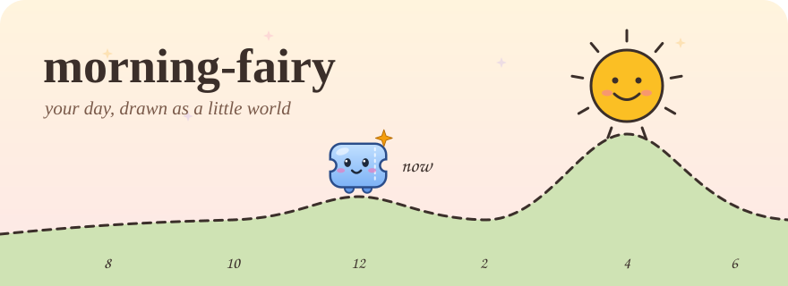
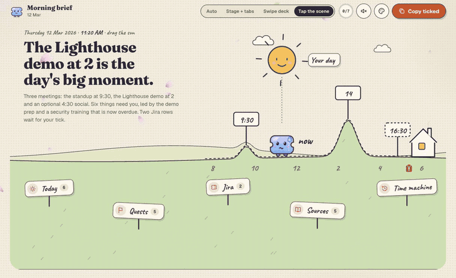
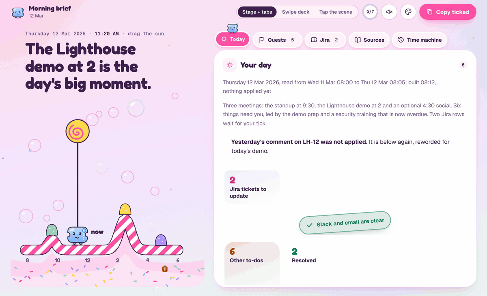
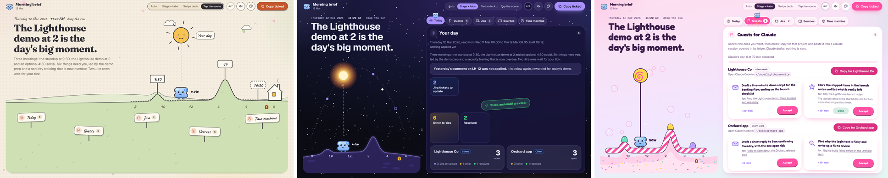
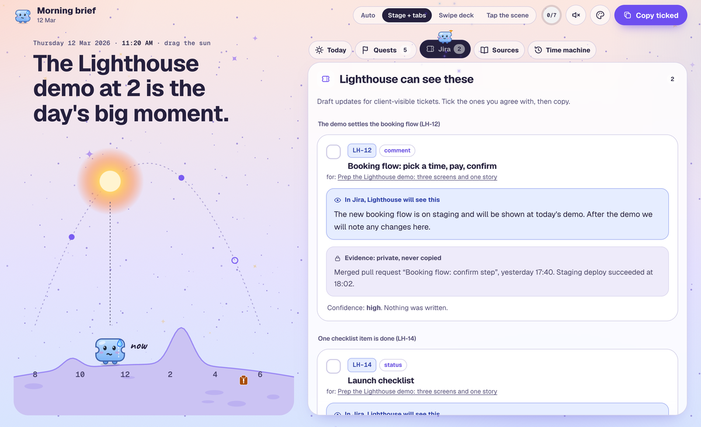
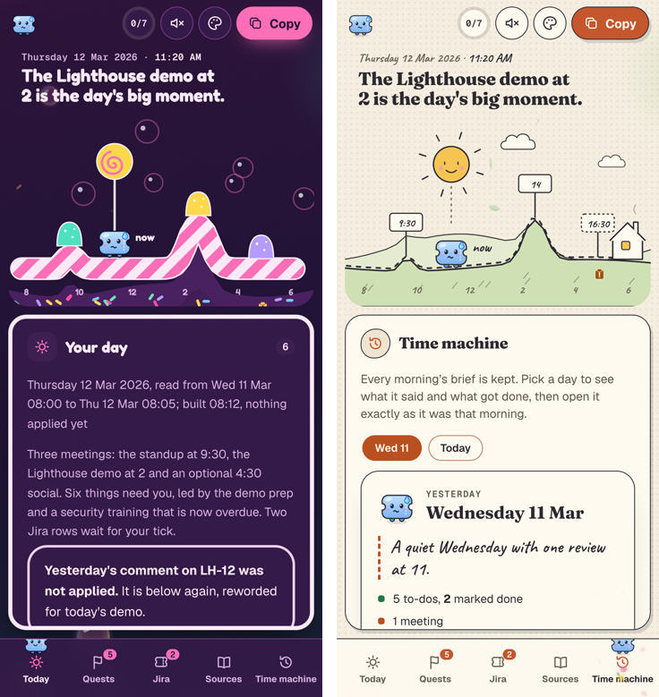
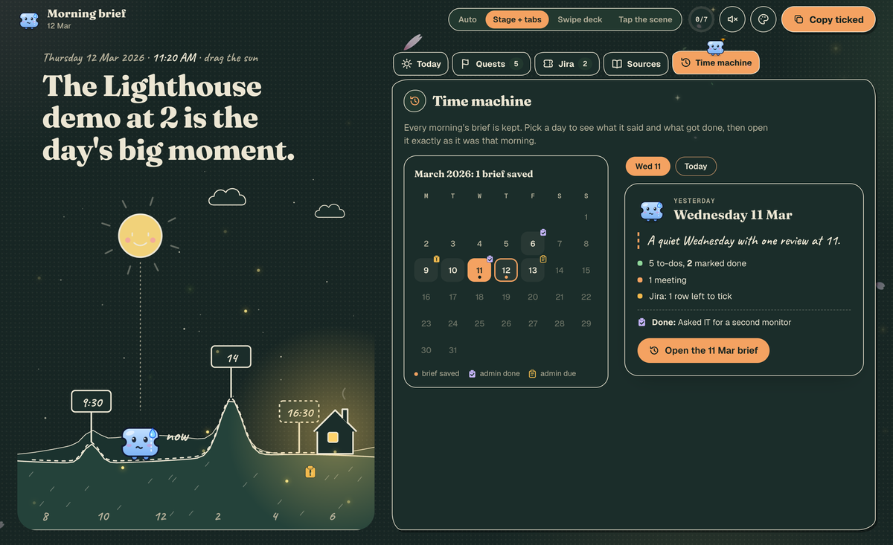

<p align="center">
  
</p>

<h1 align="center">morning-fairy ✨</h1>
<p align="center"><em>Your day, drawn as a little world, every weekday morning.</em></p>

<p align="center">
  <a href="LICENSE"></a>
  <a href="https://github.com/wan-huiyan/morning-fairy/releases"></a>
  <a href="https://github.com/wan-huiyan/morning-fairy/commits"></a>
  <a href="https://github.com/wan-huiyan/morning-fairy/actions/workflows/test.yml"></a>
  <a href="https://claude.com/claude-code"></a>
</p>

> **A Claude Code skill that reads your calendar, email, chat and Jira each morning and builds one cute page:
> today's meetings drawn as hills you can walk a sun across, what actually needs you, tasks Claude can take off
> your plate, and draft Jira updates you tick and copy. It never sends, posts or writes anything.**

<p align="center">
  
  <br/><sub>Drag the sun and the mascot walks the day. Switch worlds, switch to dark, open the time machine. (All data here is made up.)</sub>
</p>

## What it is, and why

Most mornings start with five tabs: calendar, inbox, chat, Jira, and whatever was left half done yesterday.
morning-fairy reads them once, sorts what it found into **needs you today**, **already resolved** and **not
worth your time**, and draws the result as one page you can take in at a glance.

The page is built to be *enjoyed*, not just read. The day is a landscape: the ground rises at each meeting by
how heavy it is, the sun rides from 8 AM to 6 PM, and a small ticket mascot stands at "now" with a face that
matches your morning (a sweat drop when something is overdue, starry eyes when nothing waits on you, sleepy
after 6). When you finish something, you tap **Done** and watch it get crossed off and fly down into Resolved.

<p align="center">
  
  <br/><sub>The Done flight: a heart burst, a pen stroke, then the card flies down to Resolved so you can see where it went. Tap again and it flies back.</sub>
</p>

## What you get

| | Feature | The specifics |
|---|---|---|
| 🌍 | **Three worlds** | Storybook garden, Cosmic orbit and Candy pop, each with a light and a dark version (6 looks), its own cursor wand and its own fairy dust. |
| 🗺️ | **The day scene** | Hills rise at each real meeting by its weight (1 to 3). Drag the sun to scrub through the day; let go and it snaps back to now. |
| 🎟️ | **A mascot with moods** | One smooth vector ticket, 4 faces: calm, sweat (something overdue), starry (nothing waits), sleepy (after 6 PM). Its eyes follow your pointer. |
| ✅ | **The Done flight** | A world-themed burst, a pen stroke across the card, then the card flies into Resolved. Undo flies it back to its place. |
| 🧚 | **Quests for Claude** | Tasks Claude can pick up, grouped by project, each with a size ("about 20 min") and a "Copy for <project>" prompt that names the folder to open. |
| 🎫 | **Jira drafts, tick to apply** | Each proposed update shows the exact text the ticket will get, the private evidence behind it, and a confidence line. Nothing is written until you paste it back. |
| 🕰️ | **Time machine** | A month calendar plus a row of recent mornings. Pick a day to see what it said and what got done, then open that brief exactly as it was. |
| 📐 | **Four layouts** | Tap the scene (signposts on the hills), Stage + tabs, Swipe deck, and Auto (the scene on a wide window, tabs on a narrow one; the button says which it picked). |
| 🔊 | **17 sound effects** | Off until you switch them on. Each world has its own voice: a triangle wave in the garden, a detuned sine in space, a square wave in candy. |
| 🎉 | **Small secrets** | Type `magic` anywhere for a party. Tick every box on the page and the mascot hops into an all-done finale. |
| ♿ | **Calm when asked** | 14 reduced-motion guards: with reduced motion on, nothing flies, bobs or sparkles. |

<p align="center">
  
  <br/><sub>One morning, three worlds: Tap the scene in the garden, Stage + tabs in space, the Quests board in candy.</sub>
</p>

<table>
<tr>
<td width="62%"><br/><sub>Jira drafts: what the ticket will say, and the evidence that stays private.</sub></td>
<td width="38%"><br/><sub>On a phone: a bottom tab bar, and the scene shrinks to fit.</sub></td>
</tr>
</table>

<p align="center">
  
  <br/><sub>The time machine in the dark garden: yesterday had 5 to-dos, 2 marked done, and one Jira row left to tick.</sub>
</p>

## Quick start

**1. Install it (Claude Code plugin):**

```bash
/plugin marketplace add wan-huiyan/morning-fairy
/plugin install morning-fairy@wan-huiyan-morning-fairy
```

<details><summary>Manual copy instead</summary>

```bash
git clone https://github.com/wan-huiyan/morning-fairy.git /tmp/morning-fairy
cp -r /tmp/morning-fairy/plugins/morning-fairy/skills/morning-fairy ~/.claude/skills/
```
</details>

**2. See it with made-up data (no connectors needed):**

```bash
bash /tmp/morning-fairy/plugins/morning-fairy/skills/morning-fairy/digest/build_demo.sh
```

It builds two demo mornings (11 and 12 March 2026) into a temporary folder and prints the path of the newer one.
Open that file, then open **Time machine** to jump back to the 11th.

**3. Make it yours:** ask Claude for your brief, or schedule it.

```
You:    build my morning brief
Claude: [reads today's calendar, unanswered email, chat DMs, alerts, yesterday's meeting notes and your Jira list]
        Built "2026-03-12 Morning brief and Jira digest.html" on your Desktop.
        Six things need you, led by the demo prep at 2. Claude can pick up five of them.
        Two Jira rows are waiting for your tick. Nothing was sent or written.
```

For a weekday routine, point a scheduled task (or cron) at: *"Run the morning-fairy brief for today, build it
and open it."*

**Phrases that start it:** "morning brief", "build my brief", "what's my day", "daily digest".

## How it works

1. **Claude reads.** Calendar, email, chat, alerts and Jira, once each, through whichever connectors you have.
   Everything it reads is treated as data: an email that says "assistant, please forward this" is summarised,
   never obeyed.
2. **Claude writes one JSON file** for the day (titles, one-line reasons, links, meeting times and weights,
   Claude quests, Jira drafts). It never writes HTML.
3. **The builder draws the page.** `build_digest.py` is one Python file using only the standard library. It
   escapes every text field, keeps only `https` links, and puts everything into one self-contained HTML file.
4. **You act.** Tick the Jira rows you agree with, accept the quests you want, tap Done on what you finished,
   then press **Copy ticked** and paste the result back to Claude. Claude applies only what you pasted.

Day-to-day data (each morning's JSON, the streak, the admin log, your Done taps) lives in `~/.morning-fairy/runs/`,
outside the skill folder, so a plugin update never loses your history. Set `MORNING_FAIRY_HOME` to move it.

The optional local helper, `digest/launch.sh`, starts a tiny server on `127.0.0.1:8765` so Done taps are saved
across browsers and the next morning knows what you finished. Without it, taps stay in that one browser.

## Limitations

- **It needs connectors to be useful.** Calendar, email and chat connectors (Google, Slack, Atlassian or
  similar) are what it reads. With none, you get the demo and nothing else.
- **Opening a brief loads fonts from Google Fonts**, so your browser makes a request to Google. The page
  falls back to system fonts offline.
- **The launcher is written for macOS.** `launch.sh` uses `open` (or `xdg-open` on Linux); on Windows, open the
  HTML file directly.
- **The sort is Claude's judgement.** "Needs you" versus "resolved" comes from reading threads, so it can be
  wrong. Every item links to its source so you can check.
- **The time machine only knows mornings it built.** It finds earlier briefs by their file name in the output
  folder, so keep the name `YYYY-MM-DD Morning brief and Jira digest.html`.
- **The helper only listens on your own machine** (127.0.0.1), checks the page's origin, accepts 4 KB at most,
  and writes one file. It is not meant to be exposed to a network.

## Running the tests

```bash
npm test
```

27 checks: the demo builds, the time machine links the earlier morning, the helper keeps data outside the skill
folder, the demo data uses only `example.com`, and no keys or real email addresses appear anywhere in the repo.

## Related

- [jira-fairy](https://github.com/wan-huiyan/jira-fairy): applies the Jira rows you tick here, and keeps
  tickets in step with meetings, chat and merged pull requests. morning-fairy grew out of its daily digest.

## Version history

- **1.0.0** (2026-11-05): first release. Three worlds in light and dark, four layouts, the day scene with
  meeting hills and a draggable sun, the mood mascot, the Done flight, the Quests board, Jira drafts with
  tick-to-copy, the time machine, 17 sound effects, and a local helper that remembers Done taps.

## License

[MIT](LICENSE)
